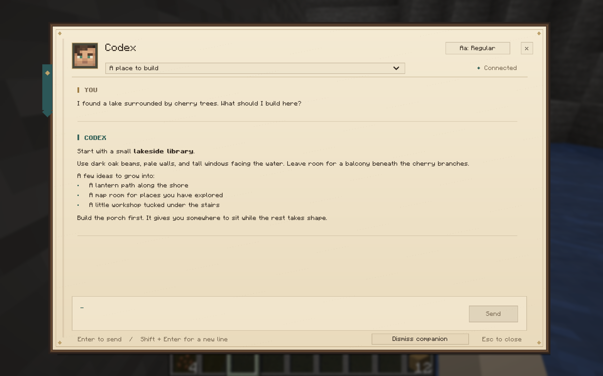

# Minecraft Companions

Talk to your existing Codex, Claude Code, and ChatGPT Dot conversations through characters in Minecraft.

Press **O** to invite a companion. Right-click the character to talk. Choose a Codex or Claude Code chat from the conversation menu. Your messages stay in the same conversation in Codex, Claude Code, or ChatGPT.

Works in singleplayer and multiplayer. Companions stay where you invite them. Each player sees their own companions.



## Requirements

This first release supports **Apple silicon Macs** with:

- Minecraft Java **26.3**, Fabric Loader **0.19.5 or newer**, and [Fabric API](https://modrinth.com/mod/fabric-api).
- [Node.js](https://nodejs.org/) **24 or newer**.
- An account with access to each companion you enable.

| Companion | Keep open while playing |
| --- | --- |
| Codex | The Codex desktop app |
| Claude | Claude Desktop installed in `/Applications`, with a local conversation in its **Code** section |
| Dot | Your Dot conversation in Google Chrome, with the included extension installed |

Use any launcher that supports this Minecraft and Fabric version. Run setup on each computer you play from.

## Install

1. Start Minecraft with Fabric once, then quit it.
2. Download **minecraft-companions-0.10.0-macos-arm64.zip** from [Releases](https://github.com/SoumilRathi/minecraft-companions/releases) and unzip it.
3. Open Terminal in the extracted folder and run:

   ```sh
   node scripts/setup.mjs
   ```

4. Enter your Minecraft game folder, the folder containing `mods` and `options.txt`. Choose the companions you want.
5. Complete the setup instructions for Claude or Dot below, then start Minecraft.
6. In **Options → Controls → Key Binds**, assign **Friends List** to another key. Minecraft 26.3 assigns it to O by default. Enter a world and press O to invite a companion.

Setup copies the mod into `mods` and installs its local connection program under `~/Library/Application Support/Minecraft Companions`. Minecraft starts that program when you enter a world. It stops after Minecraft has stopped contacting it for two minutes.

### Claude

Setup installs a small Mac app named **Claude Reconnect**. Enable it in **System Settings → Privacy & Security → Accessibility**.

This app selects Claude’s **Developer → Enable Main Process Debugger** menu item. The connection program briefly uses that debugger to load code into Claude, then closes the debugger. That code calls Claude’s existing message function with your selected chat and message. Claude handles sign-in and submits the message as user input.

Setup creates a signing key in your Mac’s Keychain so Claude Reconnect keeps its identity across updates. The key stays on your Mac. Quitting Claude leaves it closed. Opening it again lets Minecraft reconnect your selected chats.

### Dot

Enter your Dot URL during setup. Then open `chrome://extensions`, enable **Developer mode**, and choose **Load unpacked**. Select the extension folder printed by setup.

Open your Dot conversation in Chrome and sign in. Keep that tab open while playing. The extension reads the displayed conversation and uses the page’s message box and Send button. Finish or clear any draft in Chrome before sending from Minecraft.

The browser connection uses the Minecraft folder selected during the most recent setup with Dot enabled.

## In the world

- **O:** invite a companion. Inviting again brings the same character to you.
- **Right-click:** open its conversation.
- **Conversation heading:** switch Codex or Claude Code chats.
- **Enter:** send. **Shift + Enter:** add a line.
- **Dismiss companion:** remove the character from this world.

The indicators above a character show when it is working, needs your attention, or has replied. Handle tool approvals in the desktop app.

## Connections and compatibility

The local connection accepts authenticated requests on your computer’s loopback address. Chat history, selected conversations, and delivery records are stored in the game’s `config` folder. Keep that folder private when sharing a modpack.

Codex uses the desktop app’s local chat connection. An older chat can require opening it in Codex once before Minecraft can load it. Claude uses private functions inside its desktop app. Dot uses the current ChatGPT page layout. App and website updates can require a Minecraft Companions update.

The release was checked with Minecraft **26.3**, the Codex desktop app distributed as ChatGPT **26.1007.30912**, and Claude Desktop **2.31226.1** and **2.42304.0** on macOS **26.3**. This is an experimental release.

## Update or remove

To update, quit Minecraft and run setup from the new release. Choose the same game folder. Setup replaces the previous mod and keeps your conversations and companion placements. For Dot, click Reload on the extension in `chrome://extensions`, then reload the Dot tab. For Claude, quit and reopen the desktop app once to load the updated connection code.

To remove it, quit Minecraft and run `node scripts/setup.mjs --remove` from the release folder. Setup removes the mod and its installed connection files for the selected game. Your saved settings and placements remain in `config`.

Remove the Dot extension in Chrome, and quit Claude once to unload its connection code. Claude Reconnect and its signing key are shared across installations and remain available for reuse.

## Build from source

Install Node.js **24 or newer** and a **JDK 25**. Set `JAVA_HOME` to that JDK.

```sh
npm ci
npm test
cd mod
./gradlew build
cd ..
node scripts/setup.mjs
```

Building Claude Reconnect from source also requires Apple’s Command Line Tools. The release ZIP includes its compiled app.

To create the release ZIP on an Apple silicon Mac:

```sh
npm run package
```

## Credits and license

Inspired by [AgentCraft](https://github.com/blendi-remade/agentcraft). The companion artwork was created for this project with Codex and Claude.

[MIT license](LICENSE). Dependencies retain their own licenses. Minecraft Companions is an independent project.
